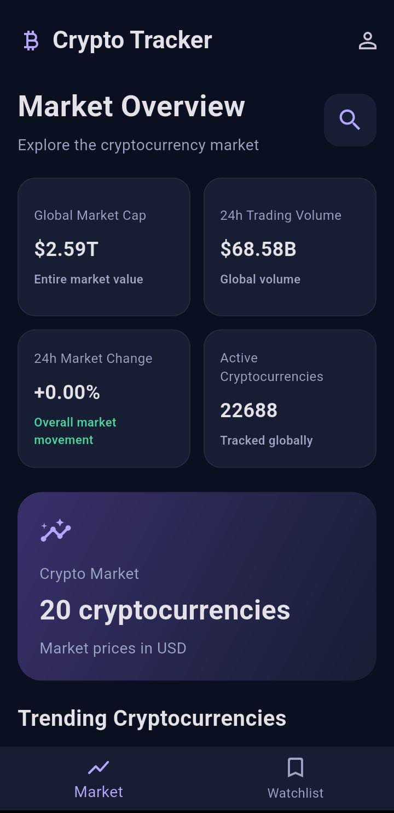
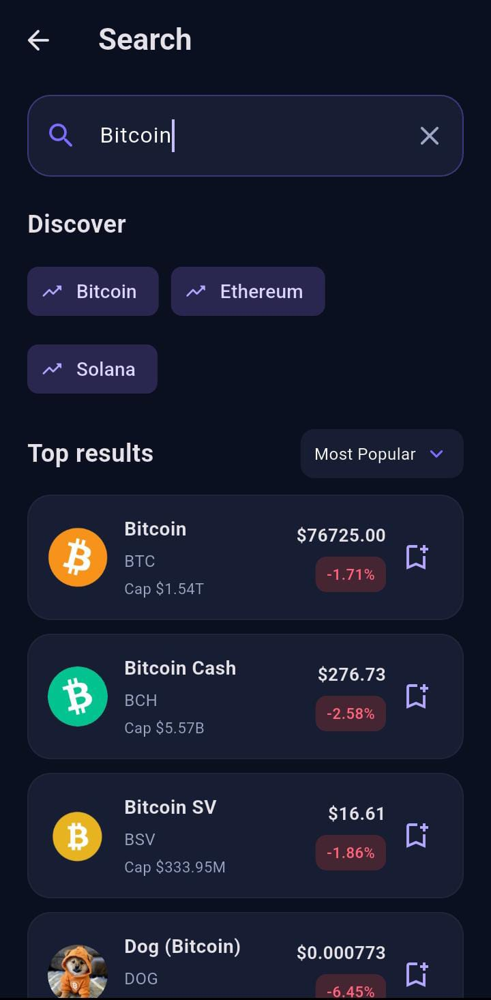
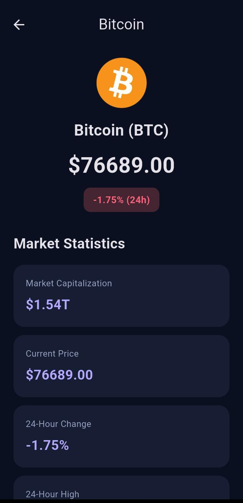
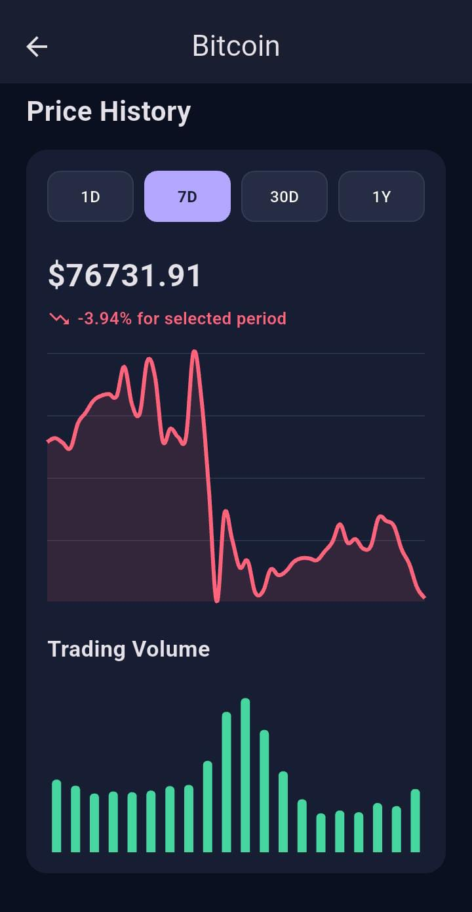
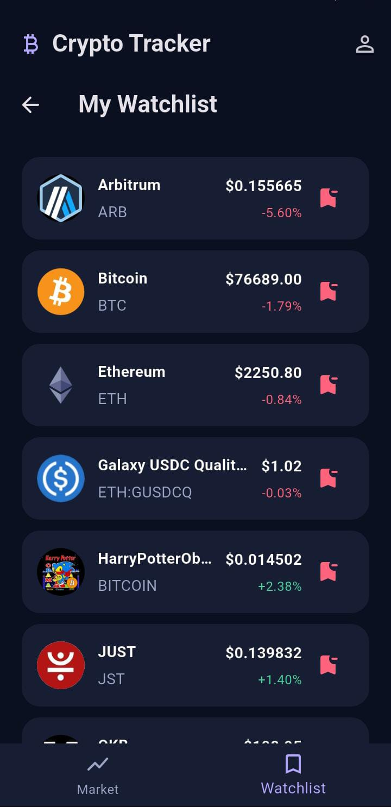
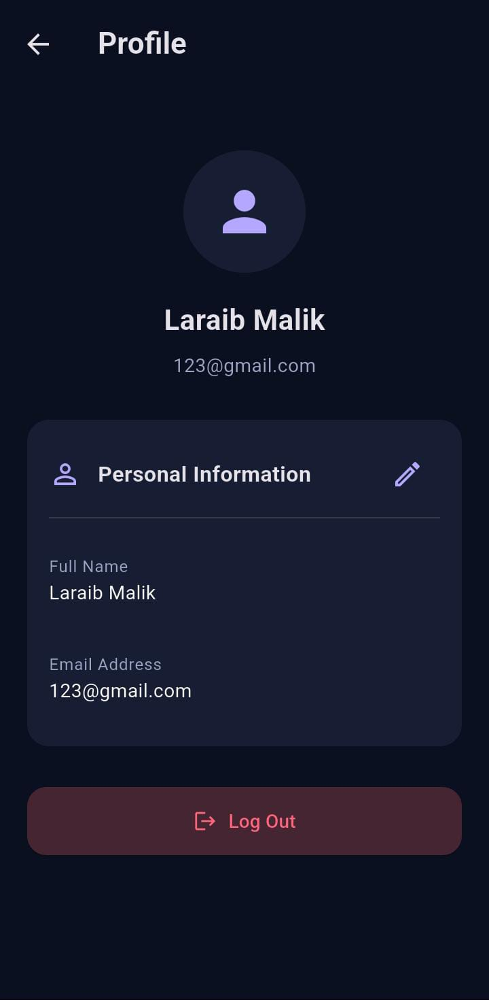

<div align="center">

# ₿ CRYPTO TRACKER

### Explore the Market. Track the Movement. Follow Your Coins.

A modern cryptocurrency tracking application built with Flutter, Dart, and Firebase.


</div>

---

## 📖 Overview

**Crypto Tracker** is a feature-rich mobile application developed using Flutter and Dart to help users explore cryptocurrency markets, monitor price movements, analyze market trends, and manage their favorite cryptocurrencies.

The application integrates the CoinGecko API for cryptocurrency market data and Firebase for user authentication and cloud-based watchlist management.

Featuring a modern dark-themed interface, Crypto Tracker brings essential cryptocurrency market information together in one convenient application.

## 📱 App Preview

### 🏠 Market Dashboard



### 🔍 Search & Discovery



### 🪙 Coin Details & Market Statistics



### 📈 Historical Price Chart



### 📊 Trading Volume & Coin Overview


### ⭐ Personal Watchlist



### 👤 User Profile



---

## ✨ Key Features

### 🌍 Global Market Overview
- Global cryptocurrency market capitalization.
- Total 24-hour trading volume.
- Global 24-hour market change.
- Number of active cryptocurrencies.

### 📊 Cryptocurrency Dashboard
- Top 20 cryptocurrencies ranked by market capitalization.
- Trending cryptocurrency section.
- Automatic market-data refresh approximately every 30 seconds.
- Top gainers and top losers.

### 🔎 Search & Sorting
- Search coins by name or symbol.
- Sort by popularity.
- Sort market capitalization from low to high.
- Sort by 24-hour percentage change from high to low.

### 📈 Coin Details & Analytics
- Current cryptocurrency prices.
- Market capitalization and 24-hour price change.
- Historical price charts.
- Trading-volume charts.
- Multiple chart intervals: 1D, 7D, 30D, and 1Y.
- Cryptocurrency descriptions and overview.

### ⭐ Personal Watchlist
- Add and remove favorite cryptocurrencies.
- Prevent duplicate watchlist entries.
- Cloud-based watchlist storage.
- User-specific Firestore access.

### 🔐 Authentication & Profile
- Email and password registration.
- Secure login and logout.
- Persistent authentication sessions.
- Profile information management.
- Edit profile name.

---

## 🔄 Application Flow

```text
       Launch Application
                |
                v
      Firebase Authentication
                |
         +------+------+
         |             |
      Sign Up         Login
         |             |
         +------+------+
                |
                v
         Market Dashboard
                |
       +--------+--------+
       |        |        |
       v        v        v
     Search  Trending  Watchlist
       |        |        |
       +--------+--------+
                |
                v
          Coin Details
                |
       +--------+--------+
       |                 |
       v                 v
  Market Statistics  Price Charts
       |
       v
 Add / Remove Coins
       |
       v
  Cloud Firestore
```

---

## 🛠️ Technology Stack

| **Layer** | **Technology** | **Purpose** |
|---|---|---|
| UI Framework | Flutter | Mobile application interface |
| Programming Language | Dart | Application logic |
| Design System | Material 3 | Modern UI components and styling |
| Authentication | Firebase Authentication | User registration and login |
| Cloud Database | Cloud Firestore | Watchlist storage and synchronization |
| Market Data | CoinGecko API | Cryptocurrency market information |
| Networking | HTTP | REST API communication |
| Data Visualization | fl_chart | Price and volume charts |
| IDE | Visual Studio Code | Application development |
| Android Build | Android SDK & Gradle | APK generation |

---

## 🏗️ Project Structure

```text

crypto-tracker-app/
│
├── android/
│
├── assets/
│   └── crypto.png
│
├── screenshots/
│   ├── dashboard.png
│   ├── search.png
│   ├── coin-details-statistics.png
│   ├── coin-details-price-history.png
│   ├── coin-details-overview.png
│   ├── watchlist.png
│   └── profile.png
│
├── lib/
│   │
│   ├── main.dart
│   ├── firebase_options.dart
│   │
│   ├── models/
│   │   └── coin_model.dart
│   │
│   ├── screens/
│   │   ├── auth_screen.dart
│   │   ├── dashboard_screen.dart
│   │   ├── search_screen.dart
│   │   ├── coin_details_screen.dart
│   │   ├── coin_market_chart.dart
│   │   ├── gainers_losers_screen.dart
│   │   ├── watchlist_screen.dart
│   │   └── profile_screen.dart
│   │
│   └── services/
│       ├── coingecko_service.dart
│       └── watchlist_service.dart
│
├── test/
│   └── widget_test.dart
│
├── .gitignore
├── .metadata
├── analysis_options.yaml
├── pubspec.yaml
├── pubspec.lock
└── README.md

```

---

## 🔌 API Integration

### CoinGecko API

The application uses the CoinGecko API to retrieve cryptocurrency market information.

Data includes:
- Cryptocurrency names and symbols.
- Current USD prices.
- Market capitalization.
- 24-hour price changes.
- Historical price information.
- Trading-volume information.

Official documentation:

[CoinGecko API Documentation](https://docs.coingecko.com/)

### Firebase Integration

**Firebase Authentication**
- Handles user registration and login.
- Maintains authentication state.
- Provides account-based access.

**Cloud Firestore**
- Stores individual user watchlists.
- Synchronizes saved cryptocurrencies.
- Uses security rules to restrict access to the authenticated owner.

Watchlist storage structure:

```text
users/
  userId/
    watchlist/
      coinId/
```

---

## 🚀 Getting Started

### Prerequisites

- Flutter SDK
- Dart SDK
- Android Studio or Visual Studio Code
- Android SDK
- Firebase project

### 1. Clone the repository

```bash
git clone https://github.com/LaraibMalik71/crypto-tracker-app.git
```

### 2. Open the project

```bash
cd crypto-tracker-app
```

### 3. Install dependencies

```bash
flutter pub get
```

### 4. Configure Firebase

1. Create your Firebase project.
2. Register your Android application.
3. Configure Firebase using FlutterFire CLI.
4. Enable Email/Password Authentication.
5. Create a Cloud Firestore database.
6. Configure secure Firestore rules.

### 5. Run the application

```bash
flutter run
```

---

## 📦 Build Android APK

Generate a release APK:

```bash
flutter build apk --release
```

APK output:

```text
build/app/outputs/flutter-apk/app-release.apk
```

---

## 🧪 Testing & Code Quality

Run automated Flutter tests:

```bash
flutter test
```

Check code quality:

```bash
flutter analyze
```

**Current project checks:** Flutter tests passed and static analysis reported no issues.

---

## 🔐 Security

- Firebase Authentication manages user accounts.
- Firestore rules restrict watchlist access by authenticated user ID.
- Android signing credentials should remain private.
- Firebase service-account private keys must never be committed to a public repository.

---

## 🎯 Project Objectives

Developed as an Android development internship project to demonstrate practical experience with:

- Flutter and Dart application development.
- REST API integration.
- Firebase Authentication.
- Cloud Firestore.
- Data visualization and charts.
- Responsive mobile UI development.
- Android APK generation and testing.

---

## 📌 Project Status

**Completed — Internship Project**

---

## 👩‍💻 About the Developer

**Laraib Malik**

🎓 IT Student | Flutter Developer

- 🐙 **GitHub:** [@LaraibMalik71](https://github.com/LaraibMalik71)
- 📧 **Email:** hh2999720@gmail.com